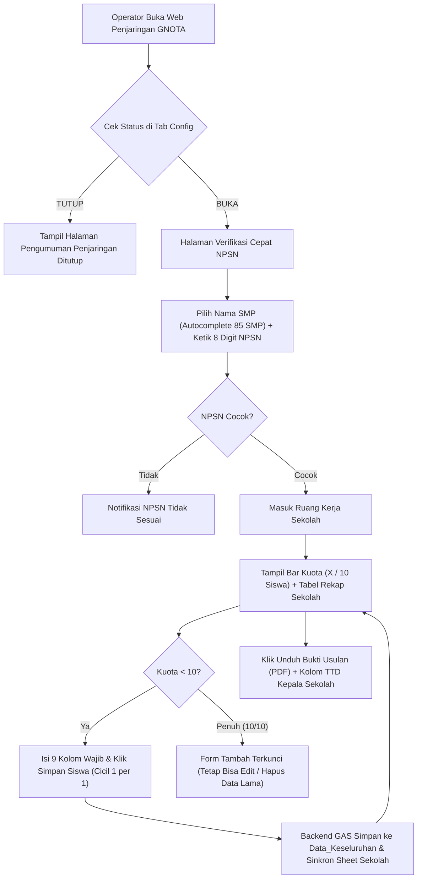

# RANCANGAN APLIKASI PENJARINGAN DATA CALON PENERIMA GNOTA TAHUN 2026 (JENJANG SMP)
**Bidang SMP — Dinas Pendidikan dan Kebudayaan Kabupaten Karanganyar**

---

## 1. Ringkasan Eksekutif

Aplikasi web sementara (*purpose-built form portal*) untuk memfasilitasi **85 Satuan Pendidikan SMP (51 Negeri & 34 Swasta)** di Kabupaten Karanganyar dalam mengusulkan **maksimal 10 siswa calon penerima bantuan Gerakan Nasional Orang Tua Asuh (GNOTA) Tahun 2026**.

Seluruh data tersimpan terpusat dan terstruktur secara *real-time* ke dalam Google Spreadsheet resmi yang telah disiapkan, baik pada lembar gabungan (**`Data_Keseluruhan`**) maupun lembar terpisah per sekolah (**`1 Sekolah = 1 Sheet`** yang dibuat otomatis saat sekolah mengisi).

| Parameter Proyek | Spesifikasi Keputusan Final |
| :--- | :--- |
| **Nama Aplikasi** | Portal Penjaringan Calon Penerima GNOTA SMP Tahun 2026 |
| **Instansi Penyelenggara** | Bidang SMP — Disdikbud Kabupaten Karanganyar |
| **Target Folder Google Drive** | `1mil1T1rg2BpiiqiyXQ2wa5NkiaHOCHny` *(Akses penuh terverifikasi)* |
| **Target Spreadsheet ID** | `1epij3WOviefWj6WWIhGtYnIb3wYWGO2FVlqXn-j8BGo` (**Data GNOTA** — *Akses penuh terverifikasi*) |
| **Sumber Master SMP** | `Master_SMP` (85 SMP Negeri & Swasta + NPSN dari sistem Bidang SMP) |
| **Batas Kuota Usulan** | Maksimal **10 siswa** per Satuan Pendidikan (SMP) |
| **Mekanisme Akses Sekolah** | **Verifikasi Cepat NPSN** (Pilih SMP + ketik 8 digit NPSN tanpa password) |
| **Kontrol Buka/Tutup Form** | Saklar langsung di tab **`Config`** pada Google Spreadsheet (tanpa menu Admin di web) |
| **Output Arsip Sekolah** | Cetak / Unduh **PDF Bukti Usulan Sekolah** (berlogo resmi + kolom TTD Kepala Sekolah) |
| **Hosting & Repositori** | GitHub Pages pada akun **`dikbudkra`** — repo baru: **`penjaringanGNOTA`** |
| **Footer Wajib** | `DIGITALLY SHAPED BY JeMPROT [BID SMP 2026]` |

---

## 2. Identitas Visual, Logo & Branding

1. **Palet Warna Tema GNOTA:**
   - **Biru Utama GNOTA (`#0D47A1` s.d. `#1976D2`):** Melambangkan kepercayaan, keteduhan, dan dunia pendidikan dasar-menengah.
   - **Oranye/Amber Kepedulian (`#F57C00` / `#FFB300`):** Melambangkan semangat gotong royong dan uluran tangan Orang Tua Asuh.
   - **Permukaan Bersih (`#F8FAFC` & `#FFFFFF`):** Kontras tinggi, ramah mata, dan nyaman diakses dari layar smartphone maupun laptop operator sekolah.
2. **Komponen Header & Splash Screen:**
   - **Logo Kabupaten Karanganyar** berdampingan dengan **Logo GNOTA (Gerakan Nasional Orang Tua Asuh)**.
   - Badge penanda jelas: **`JENJANG SMP • TAHUN 2026`**.
   - Subjudul instansi: *Dinas Pendidikan dan Kebudayaan Kabupaten Karanganyar*.
3. **Komponen Footer Wajib:**
   - Tampil konsisten di bagian bawah halaman:
     `DIGITALLY SHAPED BY` + **Logo JeMPROT** + `[BID SMP 2026]`.

---

## 3. Alur Kerja Pengguna (Operator SMP) & Panitia Dinas



---

## 4. Spesifikasi 9 Kolom Isian Wajib & Validasi

Seluruh field di bawah ini bersifat **Wajib Diisi (*Required*)** sebelum data dapat disimpan:

| No | Nama Field | Tipe Input | Aturan Validasi & Perilaku Sistem |
| :-: | :--- | :--- | :--- |
| 1 | **Nama Siswa** | Teks | Wajib diisi, otomatis dirapikan ke `HURUF KAPITAL`, sanitasi karakter aman. |
| 2 | **NISN** | Angka (10 Digit) | Wajib tepat **10 digit angka** (`0-9`). Diformat sebagai *Plain Text* di Sheet agar angka `0` di depan aman. **Anti-duplikat lintas sekolah** (menolak jika NISN sudah pernah diinput). |
| 3 | **Jenis Kelamin** | Pilihan (*Radio/Select*) | Wajib pilih: **`L`** (Laki-laki) atau **`P`** (Perempuan). |
| 4 | **Kelas** | Pilihan (*Select*) | Wajib pilih: **`Kelas 7`**, **`Kelas 8`**, atau **`Kelas 9`**. |
| 5 | **Satuan Pendidikan** | Teks Terkunci (*Readonly*) | Otomatis terisi nama SMP sesuai sesi Verifikasi Cepat NPSN (mencegah salah pilih sekolah). |
| 6 | **Nama Orang Tua / Wali** | Teks | Wajib diisi, otomatis dirapikan ke `HURUF KAPITAL`. |
| 7 | **Pekerjaan Orang Tua / Wali** | *Dropdown* + Ketik Manual | **Urutan #1 wajib `Lainnya (Ketik Manual)`** (membuka kolom ketik bebas wajib isi). **Urutan #2 dst.:** *Buruh Harian Lepas*, *Petani / Buruh Tani*, *Pedagang Kecil*, *Pekerja Serabutan*, *Asisten Rumah Tangga*, *Pengemudi / Ojek*, *Karyawan Swasta / Honorer*, *Tidak Bekerja*, *Yatim / Piatu (Ikut Wali)*. |
| 8 | **Status Penerimaan PIP** | Pilihan (*Select*) | Pilihan: **`Tidak Menerima`** / **`Menerima`**. Keduanya tetap boleh disimpan. Jika memilih **`Menerima`**, muncul kotak *imbauan halus* agar memprioritaskan siswa yang belum menerima PIP kecuali kondisi darurat/khusus. |
| 9 | **Keterangan (Alasan Dapat Diberikan Bantuan GNOTA)** | *Textarea* | Wajib diisi alasan faktual kondisi sosial-ekonomi siswa (misal: yatim/piatu, penghasilan orang tua tidak menentu, rentan putus sekolah, dll.). |

---

## 5. Arsitektur Google Spreadsheet (`1epij3WOviefWj6WWIhGtYnIb3wYWGO2FVlqXn-j8BGo`)

Saat fungsi inisialisasi `setupDatabase()` dijalankan pada Google Apps Script, sistem menyiapkan struktur berikut:

### A. Tab `Config` (Pusat Kendali Tanpa Admin Web)
Berisi pengaturan sederhana yang bisa diubah langsung oleh Mas Bos di Google Sheet kapan saja:
- `STATUS_PENJARINGAN` : **`BUKA`** atau **`TUTUP`** *(mengunci/membuka akses form web secara instan)*.
- `MAKS_SISWA_PER_SMP` : **`10`**.
- `JUDUL_KEGIATAN` : `Penjaringan Data Calon Penerima Bantuan GNOTA Jenjang SMP Tahun 2026`.
- `PESAN_PENUTUPAN` : Pesan informasi yang tampil di web ketika status diubah menjadi `TUTUP`.
- **Tabel Pantauan Otomatis 85 SMP (di sisi kanan tab `Config` / `Monitoring_SMP`):** Rumus otomatis `COUNTIF` terhadap `Data_Keseluruhan` sehingga Mas Bos bisa langsung melihat daftar SMP yang **Sudah Mengisi (`1–10`)** maupun **Belum Mengisi (`0`)** tanpa perlu halaman admin di web.

### B. Tab `Master_SMP`
- Berisi **85 SMP Negeri & Swasta Kabupaten Karanganyar** (`NPSN`, `Nama Satuan Pendidikan`, `Status Sekolah`, `Kecamatan`) yang disalin dari database referensi Bidang SMP (`17OxbZ2Je54HT3wIN-s_XbehVe6JE5L-UrSikTFQ8cDo`).

### C. Tab `Data_Keseluruhan`
Rekap induk seluruh calon penerima dari semua SMP dengan kolom:
1. `ID_Usulan` *(UUID unik untuk keperluan Edit/Hapus presisi)*
2. `No` *(Nomor urut otomatis)*
3. `Waktu Input` *(Timestamp WIB)*
4. `NPSN`
5. `Satuan Pendidikan`
6. `Nama Siswa`
7. `NISN`
8. `Jenis Kelamin`
9. `Kelas`
10. `Nama Orang Tua/Wali`
11. `Pekerjaan Orang Tua/Wali`
12. `Status Penerimaan PIP`
13. `Keterangan (Alasan GNOTA)`

### D. Tab Per Sekolah — Dibuat *On-Demand* (`[Nama Satuan Pendidikan]`)
- **Bebas Tab Kosong:** Tab sekolah (contoh: `SMP N 1 KARANGANYAR`) **hanya dibuat otomatis** ketika sekolah tersebut menyimpan minimal 1 siswa.
- **Format Siap Cetak:** Dilengkapi judul kop nama sekolah & NPSN di baris atas, header tabel berwarna biru GNOTA, border rapi, dan nomor urut `1 s.d. 10`.
- **Sinkronisasi 2 Arah Otomatis:** Setiap aksi *Tambah*, *Edit*, atau *Hapus* oleh operator sekolah di web akan memperbarui `Data_Keseluruhan` sekaligus menulis ulang tabel di sheet khusus sekolah tersebut secara presisi menggunakan `LockService` (mencegah tabrakan data saat banyak sekolah akses bersamaan). Jika sekolah menghapus seluruh siswanya hingga `0`, sheet sekolah tersebut otomatis dihapus kembali agar daftar tab tetap bersih.

---

## 6. Fitur Cetak / Unduh Bukti Usulan Sekolah (PDF)

Di bawah tabel rekap ruang kerja sekolah, tersedia tombol **"Cetak / Unduh Bukti Usulan (PDF)"**:
- Sebelum mengunduh, muncul modal ringan opsional untuk mengisi **Nama Kepala Sekolah**, **NIP**, dan **Tanggal Surat/Usulan** (boleh dikosongkan jika ingin ditulis tangan).
- Menghasilkan dokumen PDF ukuran **A4 Landscape** yang rapi:
  - Kop berlogo **Kabupaten Karanganyar** & **GNOTA** (*Daftar Usulan Calon Penerima Bantuan GNOTA Jenjang SMP Tahun 2026*).
  - Identitas Sekolah (Nama Satuan Pendidikan, NPSN, Kecamatan, Jumlah Usulan).
  - Tabel lengkap 9 kolom siswa yang diusulkan.
  - Blok pengesahan / tanda tangan **Kepala Sekolah** di kanan bawah + watermark footer kecil sistem.

---

## 7. Struktur File & Rencana Deployment

```text
Penjaringan GNOTA 2026/              (Repo GitHub: dikbudkra/penjaringanGNOTA)
├── index.html                       # Halaman utama SPA (Splash, Verifikasi NPSN, Form & Tabel Rekap)
├── assets/
│   ├── css/
│   │   └── style.css                # Tema visual GNOTA, responsif mobile-first & print-friendly
│   ├── js/
│   │   └── app.js                   # Logika frontend, API client GAS, validasi, & generator PDF
│   └── img/
│       ├── logo-karanganyar.png     # Logo resmi Pemkab Karanganyar
│       ├── logo-gnota.svg           # Logo resmi/vektor GNOTA bersih resolusi tinggi
│       └── logo-jemprot.png         # Logo branding footer JeMPROT
├── backend/
│   └── Code.gs                      # Kode Google Apps Script (API + Auto-Setup 85 Master SMP + Sheet Sync)
├── RANCANGAN_PENJARINGAN_GNOTA_2026.md
└── README.md                        # Panduan singkat pasang Code.gs & penggunaan
```

### Tahapan Eksekusi Setelah Rancangan Disetujui:
1. Menyiapkan aset logo (`logo-karanganyar.png`, `logo-gnota.svg`, `logo-jemprot.png`) di folder `assets/img/`.
2. Membangun **`backend/Code.gs`** lengkap dengan daftar 85 SMP Karanganyar terintegrasi, `LockService`, proteksi kuota 10 siswa/SMP, anti-duplikat NISN, dan generator sheet sekolah *on-demand*.
3. Membangun frontend **`index.html`**, **`style.css`**, dan **`app.js`** dengan tampilan khas GNOTA, Verifikasi Cepat NPSN, form 9 kolom (dropdown Pekerjaan dengan *"Lainnya"* di urutan #1), tabel edit/hapus, fitur unduh PDF Bukti Usulan, dan footer wajib `DIGITALLY SHAPED BY JeMPROT [BID SMP 2026]`.
4. Membuat repositori baru **`penjaringanGNOTA`** pada akun GitHub **`dikbudkra`**, melakukan *push*, dan mengaktifkan GitHub Pages (`https://dikbudkra.github.io/penjaringanGNOTA/`).
5. Menyambungkan URL Web App Google Apps Script dari Spreadsheet `1epij3WOviefWj6WWIhGtYnIb3wYWGO2FVlqXn-j8BGo` ke frontend dan melakukan pengujian *end-to-end*.
